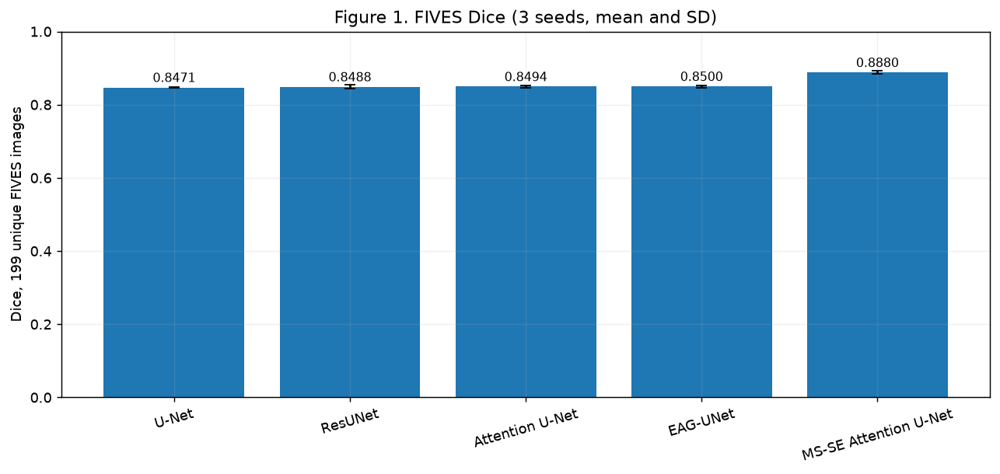
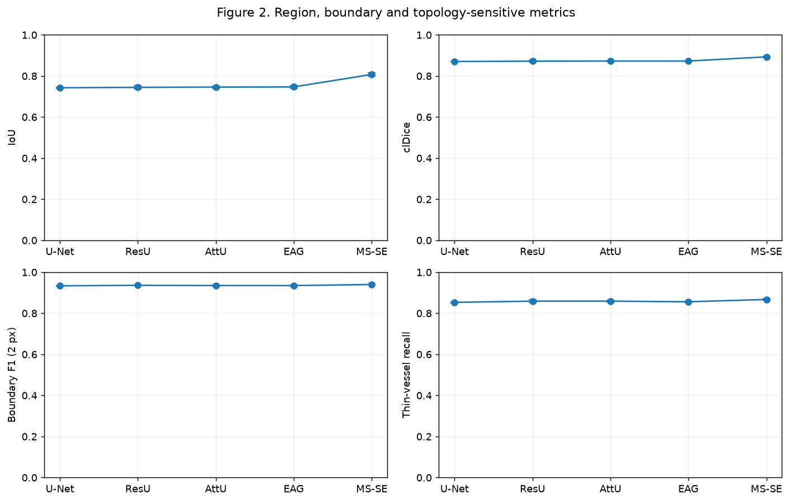
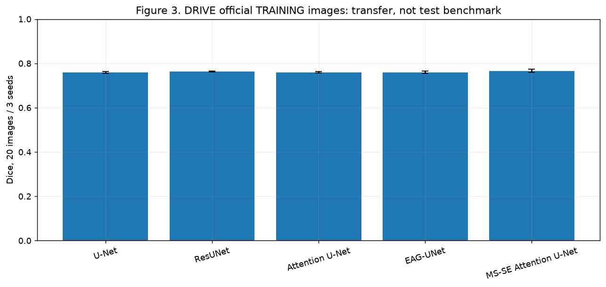
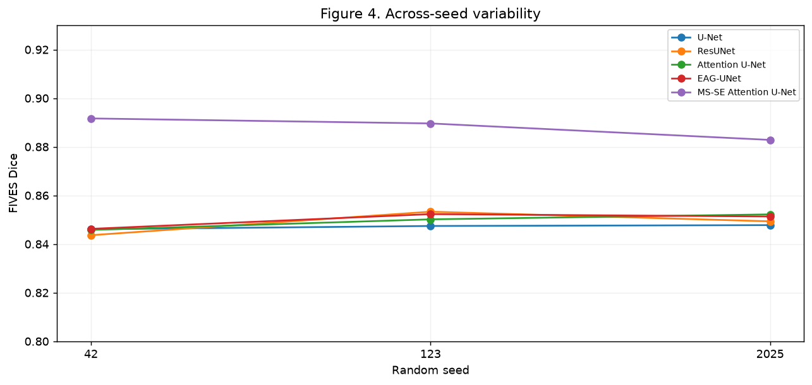
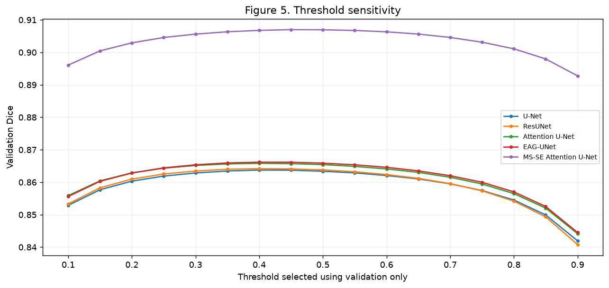
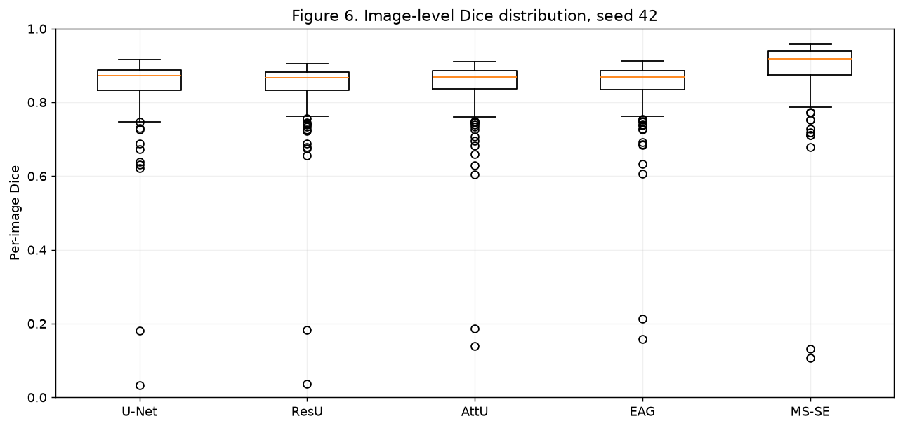
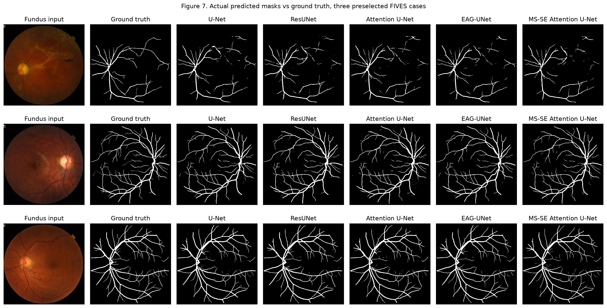
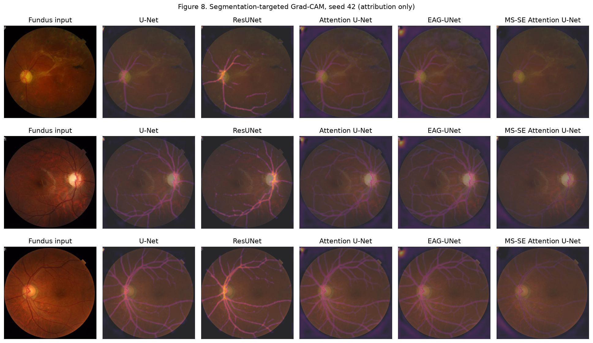

# EAG-UNet | Leakage-Audited Multi-Seed Retinal Vessel Segmentation

**Research reproducibility package, IEEE Access manuscript ID Access-2026-43389.**

The primary output is a single executable notebook: [EAG_UNet_Complete_Experiment_Analysis.ipynb](EAG_UNet_Complete_Experiment_Analysis.ipynb). It reads existing experiments, independently validates 15 completed run summaries, recomputes statistics, produces Figures 1–6, and optionally loads trained checkpoint weights to calculate real binary predictions and segmentation-targeted Grad-CAM Figures 7–8. **No model training is performed.**

## 1. Purpose and scientific claims

This repository evaluates whether conventional additive attention-gated skip fusion alone yields a measurable benefit over standard Attention U-Net, and contrasts this with a multiscale plus squeeze-and-excitation encoder. **EAG-UNet and Attention U-Net use the same established attention-gate mechanism and parameter count** in the verified code. No new attention gate is claimed. The current evidence supports a careful comparative/negative-result analysis, not an unverified architectural invention.

## 2. Datasets, partition audits and full protocol

| Item | Verified procedure |
|---|---|
| Main dataset | FIVES, 800 image-mask entries (600 official training, 200 official test) |
| Clean splitting | Train 510, validation 90 for each seed; exact SHA-256 image-byte groups disjoint |
| Duplicate handling | Official train: 595 distinct input image contents; official test: 200 labels for 199 distinct image contents |
| Test aggregation | Per-image metric first; identical input image-content hashes given one vote in final mean |
| Seeds | 42, 123 and 2025 for each of five architectures |
| Inputs | RGB 512 x 512 normalized to [0,1]; masks nearest-neighbor resize |
| Training | Adam, learning rate 1e-4; batch 4; max 120 epochs; patience 15 |
| Objective | Binary cross-entropy plus soft Dice loss |
| Augmentation | Training only: flips, brightness, contrast |
| Selection | Checkpoint selected on validation Dice; threshold grid 0.10-0.90 in 0.05 steps selected using validation |
| External transfer | DRIVE official **training** partition, 20 images with first-observer manual masks. Not official DRIVE test results |
| Grouping limitation | SHA-256 exact matching does NOT prove subject-level or acquisition-level independence |

FIVES dataset: Jin et al., Scientific Data 9, 475 (2022), DOI [10.1038/s41597-022-01564-3](https://doi.org/10.1038/s41597-022-01564-3). Original FIVES data are available through the source article/Figshare, which lists CC BY 4.0; cite and credit the dataset when using reproduced images. Images and weights are not included in this repository.

## 3. Main FIVES and external-transfer results

These are **observed results** from 15 audited final evaluations, not validation scores. Each statistic is mean +/- sample SD across three seeds.

| Model | Parameters | FIVES Dice mean +/- SD | clDice mean +/- SD | DRIVE transfer Dice mean +/- SD |
|---|---:|---:|---:|---:|
| U-Net | 4,080,937 | 0.847105 +/- 0.000890 | 0.870563 +/- 0.000375 | 0.759225 +/- 0.004027 |
| ResUNet | 4,182,649 | 0.848770 +/- 0.004859 | 0.872108 +/- 0.003137 | 0.763081 +/- 0.002029 |
| Attention U-Net | 4,130,441 | 0.849395 +/- 0.003266 | 0.872888 +/- 0.002133 | 0.759897 +/- 0.003266 |
| EAG-UNet | 4,130,441 | 0.849967 +/- 0.003254 | 0.872827 +/- 0.001335 | 0.759794 +/- 0.005744 |
| MS-SE Attention U-Net | 5,253,038 | 0.888042 +/- 0.004624 | 0.893107 +/- 0.003100 | 0.766352 +/- 0.007234 |

### Mean paired differences (Dice)

| Comparison (candidate minus reference) | Mean Delta Dice | 95% CI | Paired t p |
|---|---:|---:|---:|
| EAG_UNet vs U_Net | 0.002861 | [-0.003194, 0.008916] | 0.1791 |
| EAG_UNet vs ResUNet | 0.001197 | [-0.003590, 0.005984] | 0.3946 |
| EAG_UNet vs Attention_UNet | 0.000572 | [-0.003198, 0.004342] | 0.5807 |
| EAG_UNet vs MS_SE_Attention_UNet | -0.038075 | [-0.055440, -0.020711] | 0.0110 |
| MS_SE_Attention_UNet vs Attention_UNet | 0.038648 | [0.019651, 0.057644] | 0.0128 |

**Interpretation.** EAG vs Attention U-Net: Delta Dice +0.000572, p=0.5807, 95% paired CI [-0.003198, 0.004342]. This does not establish superiority. MS-SE vs Attention U-Net: Delta +0.038648, p=0.0128. The latter is a **difference observed under this protocol**, not a claim of new architectural novelty. With three seeds, t-based confidence intervals are uncertain and p-values are exploratory; adjust for multiple comparisons before treating any family of tests as confirmatory.

## 4. Architecture and efficiency

All five models use a same-resolution encoder-decoder workflow. EAG-UNet is mathematically and structurally equivalent to the conventional Attention U-Net baseline in the inspected experiment code, with **4,130,441** trainable parameters each. U-Net has 4,080,937; ResUNet has 4,182,649; MS-SE Attention U-Net has 5,253,038. The MS-SE encoder adds parallel 3x3 and 5x5 convolutions, projection, batch normalization, and squeeze-and-excitation before the gated decoder. These are known ingredients. Parameters alone cannot establish runtime efficiency, FLOPs, FPS or peak GPU memory; these values are not invented here.

## 5. Figure gallery

### FIVES three-seed Dice



### IoU, clDice, boundary F1 and thin-vessel recall



### DRIVE training-partition transfer



### Seed variability



### Validation threshold sensitivity



### Per-image FIVES Dice



### Checkpoint-derived predictions



### Segmentation-targeted Grad-CAM



Figure 7 presents **real predicted masks** against FIVES ground truth, using seed-42 weights for all models and exactly the same three images. The three cases are determined beforehand from EAG-UNet Dice at the 10th, 50th, and 90th percentiles (IDs in the selection CSV). Figure 8 uses a Segmentation-targeted Grad-CAM target: mean foreground probability within predicted vessel pixels, back-propagated to an intermediate convolutional tensor. Grad-CAM is qualitative attribution, not a numerical measure of segmentation quality, an explanation of disease, or evidence of clinical safety.

## 6. Repository structure

```
EAG-UNet/
  README.md
  EAG_UNet_Complete_Experiment_Analysis.ipynb
  requirements.txt
  DATA_AVAILABILITY.md
  figures/
    fig01_fives_dice.png
    fig02_four_metrics.png
    fig03_drive_training_transfer.png
    fig04_seed_variability.png
    fig05_threshold_sensitivity.png
    fig06_image_level_boxplots.png
    fig07_prediction_grid.png
    fig08_gradcam_grid.png
  results/
    gradcam_attribution_manifest.csv
    model_metrics_mean_sd_ci95.csv
    paired_Dice_t_tests.csv
    per_image_metrics_15.csv
    qualitative_case_selection.csv
    run_level_metrics_15.csv
    validation_threshold_curves.csv
  .gitignore
```

## 7. Reproduce the results

1. Install the dependencies listed in [requirements.txt](requirements.txt) in Python/WSL with TensorFlow, SciPy, Matplotlib, Pandas, PIL and OpenCV. The validated environment used TensorFlow **2.20.0** on WSL and an NVIDIA RTX 3070 Ti Laptop GPU.
2. For full end-to-end re-execution, arrange the **original** FIVES dataset, the previously created SHA-256 grouped-split manifest, all 15 per-image result CSVs and exact seed-42 model checkpoints in the experiment folder expected by the notebook. Set the EAG_EXPERIMENT_ROOT environment variable to the directory containing LEAKSAFE_FIVES_RETRAIN_V1 and LEAKSAFE_FIVES_SPLITS_V1, or run the notebook from its package folder nested directly under that experiment root.
3. Open the notebook in VS Code (WSL Python kernel). Run cells in order; there is **no fit() or retraining**. The first analysis cells verify every checkpoint and recompute per-image Dice from CSV before plotting.
4. For the figures derived only from CSVs, use the pre-generated [results](results/) files and [figures](figures/) images. For Fig. 7/8 reproduction, set RUN_GRADCAM=True, provide FIVES test source images/masks and unmodified model weights. If TensorFlow/GPU is unavailable, set RUN_GRADCAM=False; this avoids the inference block.
5. Do not combine older EAG gating-ablation and VDRG outcomes with the audited results without demonstrating identical splits, processing, model training, and test aggregation.

## 8. Verification and limitations

- Every 15 run folders was checked for best.weights.h5, train_summary.json, evaluation_summary.json and per-image test_metrics.csv; Dice recomputed exactly from 199 distinct SHA-256 input contents per seed.
- 20 DRIVE training-partition entries were verified for each run, so external results cannot be called a DRIVE official test benchmark.
- Checkpoint-derived Grad-CAM and predicted masks were generated with **no retraining** from the saved 42-seed checkpoint and fixed validation threshold for each of the five models.
- An image-byte hash catches exact duplicates, but not near duplicates, multiple photos from the same patient, or shared acquisition sessions.
- Prior biomarker analyses contain incompatible tortuosity-proxy definitions and were omitted rather than reported as clinically valid. We make no clinical diagnostic claim.
- Attribution images include transformed/annotated publicly released FIVES samples; when reusing the figures credit FIVES creators and the original publication, and verify upstream dataset terms.

## 9. Data availability, licensing, and research ethics

The source fundus photographs, full binary annotations, and trained checkpoint binaries are not committed. The repo includes computed summaries, individual-image numeric scores without original local filesystem paths, visualizations, and analytic code. No licence is asserted for independently authored code until repository maintainers select one; FIVES images remain under the source dataset's own conditions. This is a scientific software reproducibility package, not a medical device.

## 10. Authors and citation

Prepared as the open-research computational appendix for manuscript **Access-2026-43389**. For scientific citation, reference the final published manuscript when available and separately cite the FIVES dataset. A final journal publication has **not** been claimed.
